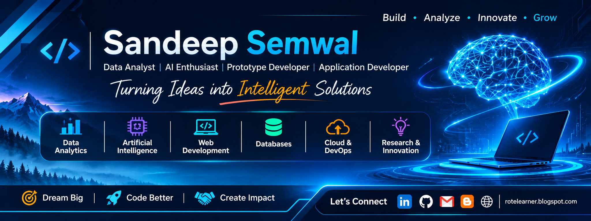

# 👋 Hi, I'm Sandeep Semwal

\
   \ \

\
   \ \

\
   \<a href="[https://www.linkedin.com/in/sandeep-semwal-343a0019a/](https://www.linkedin.com/in/sandeep-semwal-343a0019a/)">     \   \</a>   \<a href="mailto\:semwalsandeep00\@gmail.com">     \   \</a>   \<a href="[https://rotelearner.blogspot.com/](https://rotelearner.blogspot.com/)">     \   \</a>   \<a href="[https://github.com/Sandeepsem](https://github.com/Sandeepsem)">     \   \</a> \

\
   \ \

---

## 🚀 About Me

I'm **Sandeep Semwal**, a technology enthusiast focused on building practical, data-driven, and AI-powered solutions.

My interests combine **Data Analytics, Research, Artificial Intelligence, Software Development, and Rapid Prototyping**. I enjoy exploring how technology can solve real-world problems, improve existing processes, and create better digital experiences.

I believe that technology becomes valuable when it transforms an idea into something useful, measurable, and accessible.

My approach is not limited to writing code. I focus on understanding the problem, researching possible solutions, analyzing requirements, designing workflows, developing prototypes, testing functionality, and continuously improving the final product.

### 🎯 My Professional Focus

- 📊 **Data Analytics:** Exploring data, identifying patterns, performing analysis, and converting information into meaningful insights.
- 🔬 **Research & Analysis:** Studying business requirements, technical concepts, workflows, and problem-solving approaches.
- 🤖 **Artificial Intelligence:** Exploring AI-powered applications, Generative AI, LLMs, RAG systems, and Agentic AI.
- 💻 **Prototype Development:** Converting ideas and requirements into functional prototypes and application concepts.
- 🌐 **Application Development:** Working on web-based platforms, dashboards, management systems, and digital products.
- ⚙️ **Technology Integration:** Exploring APIs, databases, cloud platforms, automation, and deployment workflows.

### 💡 What Drives Me

> I don't just want to understand how technology works. I want to understand why it is needed, where it can be applied, and how it can create measurable value.

---

## 🧭 Areas of Interest & Expertise

| Domain                  | Focus Areas                                              |
| ----------------------- | -------------------------------------------------------- |
| Data Analytics          | Data Cleaning, EDA, Data Visualization, Reporting        |
| Research & Analysis     | Requirement Analysis, Technical Research, Business Logic |
| Artificial Intelligence | Generative AI, LLMs, RAG, AI Applications                |
| Agentic AI              | AI Agents, Workflow Automation, Multi-Step Processes     |
| Prototype Development   | POC Development, MVP Concepts, Rapid Prototyping         |
| Web Development         | Frontend, Backend, REST APIs, Application Integration    |
| Database Management     | SQL, Relational Databases, NoSQL                         |
| Deployment & DevOps     | Docker, VPS, Nginx, Application Deployment               |

---

## 🛠️ Technology Stack

I work with and continuously explore technologies across data, development, AI, databases, and deployment.

### 📊 Data Analytics & Data Science

\
   \   \   \   \   \   \   \ \

**Key Concepts:**

- Data Cleaning and Preprocessing
- Exploratory Data Analysis (EDA)
- Data Transformation and Manipulation
- Statistical Analysis
- Data Visualization and Reporting
- Feature Engineering
- Machine Learning Fundamentals
- Data Interpretation and Insights

### 🤖 Artificial Intelligence & Generative AI

\
   \   \   \   \   \   \ \

**Areas I'm Exploring:**

- Large Language Models (LLMs)
- Retrieval-Augmented Generation (RAG)
- Prompt Engineering
- AI-Powered Applications
- Agentic AI Workflows
- AI-Based Career Guidance Systems
- Knowledge-Based Chatbots
- Local LLM Integration
- Intelligent Workflow Automation

### 💻 Programming & Web Development

\
   \   \   \   \   \   \ \

**Development Areas:**

- Python Programming
- JavaScript Development
- React-Based Interfaces
- Responsive Web Applications
- Backend API Development
- FastAPI and Flask
- REST API Integration
- Application Logic and Workflows

### 🗄️ Databases & Backend Services

\

&#x20; \
&#x20; \
&#x20; \
&#x20; \
&#x20; \
&#x20; \
\

**Key Areas:**

- Database Design and Management
- SQL Queries
- Data Storage and Retrieval
- Backend Integration
- Authentication and Data Access
- API-Based Database Communication

### ⚙️ Tools, Deployment & Development Environment

\

&#x20; \
&#x20; \
&#x20; \
&#x20; \
&#x20; \
&#x20; \
&#x20; \
\

**Tools & Platforms:**

- VS Code
- Jupyter Notebook
- Google Colab
- Git and GitHub
- Docker and Docker Compose
- VPS Hosting
- Nginx
- Cloud Deployment
- Postman
- Figma
- Canva
- Photoshop

---

## 🧪 Projects & Product Development

I enjoy working on practical digital solutions that combine business requirements, data, technology, and user experience.

### 1. APTELO – AI-Powered Career Platform

**Focus:** Career Assessment | Career Guidance | AI | Education Technology

APTELO is a career-focused platform concept built around helping students and professionals explore career possibilities and make informed career decisions.

- Career assessment and guidance concepts.
- Career information and educational resources.
- Career-focused digital experiences.
- Exploration of AI-powered career assistance.
- Development of structured career knowledge resources.

**Explore:**

- [APTELO](https://aptelo.in)
- [APTELO Career Library](https://aptelo.online)

### 2. Student Management & Campus Solutions

**Focus:** Education Technology | Management Systems | Web Applications

Experience building student and staff management solutions with features designed to support educational institutions and their administrative workflows.

- Student information management.
- Staff-related management functionality.
- Administrative workflows.
- Web-based management interfaces.
- Database-driven application functionality.

**Explore:**

- [NGCampus](https://ngcampus.online)
- [WTech IT Solution – Management Platform](https://wtechitsolution.online)

### 3. Business & Website Development

**Focus:** Web Development | Digital Solutions | Application Interfaces

Working on websites and digital platforms that support business presence, information delivery, and online services.

- Website development.
- Responsive user interfaces.
- Content and information presentation.
- Application integration.

**Explore:**

- [WTech IT Solution](https://wtechitsolution.com)
- [NGCampus](https://ngcampus.live)

### 4. AI & Data Analytics Prototypes

**Focus:** Artificial Intelligence | Research | Data Analytics | Proof of Concept

Exploring prototype ideas that combine data analysis, intelligent automation, and practical application development.

Areas of exploration include:

- AI-based career transition analysis.
- Resume and profile analysis concepts.
- RAG-based knowledge assistants.
- Intelligent data-driven applications.
- AI-assisted research and reporting.
- Analytics dashboards and reporting solutions.

---

## 🔬 Research & Development Interests

I'm particularly interested in exploring how emerging technologies can be applied to practical business and user problems.

| Research Area        | Exploration                                                               |
| -------------------- | ------------------------------------------------------------------------- |
| Agentic AI           | Building intelligent workflows that can plan and perform multi-step tasks |
| RAG Systems          | Connecting language models with structured knowledge sources              |
| Career Intelligence  | Data-driven career exploration and career transition concepts             |
| Data Analytics       | Transforming raw datasets into meaningful insights                        |
| AI Prototyping       | Converting AI concepts into functional proof of concepts                  |
| Automation           | Reducing repetitive tasks through intelligent workflows                   |
| Education Technology | Developing digital solutions for students and institutions                |

---

## 🔄 My Development Philosophy

I follow a structured, problem-solving approach while developing a solution.

\
   \   \   \   \   \   \   \ \

1. **Understand:** Identify the actual problem and its objectives.
2. **Research:** Study the domain, existing solutions, and technical possibilities.
3. **Analyze:** Break down requirements, workflows, and business logic.
4. **Design:** Plan the architecture, data flow, and user experience.
5. **Prototype:** Create a working proof of concept.
6. **Develop:** Build and integrate the required components.
7. **Validate:** Test functionality, logic, and output.
8. **Improve:** Refine the solution based on observations and feedback.

---

## 📈 GitHub Analytics

\

&#x20; \
&#x20; \
\

\

&#x20; \
\

### 🏆 GitHub Achievements

\

&#x20; \
\

### 🐍 Contribution Activity

\

&#x20; \
\

---

## 🌱 Currently Learning & Exploring

Technology is continuously evolving, and I believe learning should be a continuous process.

My current areas of exploration include:

- Advanced Data Analytics and Visualization.
- Practical applications of Generative AI.
- Large Language Model integration.
- Retrieval-Augmented Generation (RAG).
- Agentic AI and intelligent automation.
- AI-powered application development.
- Data-driven decision-making systems.
- Scalable application architecture and deployment.

---

## 🤝 Let's Connect & Collaborate

I'm interested in connecting with developers, data professionals, researchers, AI enthusiasts, and people working on meaningful technology projects.

Whether it's a discussion about data analytics, an AI prototype, a research idea, or a software development project, I'm always interested in learning and exchanging ideas.

\

&#x20; \<a href="[https://www.linkedin.com/in/sandeep-semwal-343a0019a/](https://www.linkedin.com/in/sandeep-semwal-343a0019a/)">
&#x20;   \
&#x20; \</a>
&#x20; \<a href="mailto\:semwalsandeep00\@gmail.com">
&#x20;   \
&#x20; \</a>
&#x20; \<a href="[https://rotelearner.blogspot.com/](https://rotelearner.blogspot.com/)">
&#x20;   \
&#x20; \</a>
\

\

&#x20; \<b>📧 Email:\</b> semwalsandeep00\@gmail.com
\

---

\

&#x20; \
\

\

&#x20; \<b>Thanks for visiting my GitHub profile!\</b>
&#x20; \ 
&#x20; \<i>Explore. Learn. Build. Innovate.\</i>
\

\

&#x20; \
\

